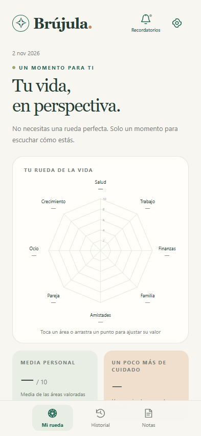

# Brújula 1.1.0

An offline Android wheel-of-life app with optional local reflection reminders. No account, server, analytics, or Internet permission. Spanish and English interfaces are included.

**[Download Brújula](https://anderrow.github.io/brujula/)** · [Latest release](https://github.com/anderrow/brujula/releases/latest) · [Direct APK download](https://github.com/anderrow/brujula/releases/latest/download/Brujula.apk)



## Install or update

Download `Brujula-1.1.0.apk` from this repository's **Releases** section, copy it to the phone, open it in Files, and choose Install or Update. Allow installation from that source if Android asks. Requires Android 8.0 / API 26 or later and an up-to-date Android System WebView. The universal APK has no native CPU-specific dependencies. Release checksums are provided alongside the APK.

The APK uses the same application ID and release signing key as earlier versions. Updating in place preserves existing data. **Do not uninstall to update.**

## A clean starting point

New installations contain **no preset scores, notes, or historical evaluations**. All eight categories start as Not rated / Sin valorar. An unanswered category is different from an intentional zero. Your first saved check-in is created only after you explicitly rate all eight categories and save.

Existing installations retain their data during an update. To clear an existing installation, open Settings → **Clear data and start fresh** and confirm. This deletes scores, notes, and history and disables the reminder. Export a backup first if you want to keep the old data.

## Reflection and history

Tap a chart label or an area row to rate it from 0 to 10 and add a note. Rated chart points can be dragged. Changes are saved automatically. Save a named check-in to create a historical snapshot; later edits cannot change its notes or scores. The history view includes category trends and overlays for comparison. Notes are also accessible in their own tab.

The displayed average uses only rated categories until all eight are complete. A blank wheel has no average and does not suggest a category needing improvement.

## Optional reminders

Open Settings → **Reflection reminder**. Reminders are off by default. Enable the switch, choose one of these schedules, select a local time, and save:

- Every day.
- One selected day of the week, Monday through Sunday.
- One selected day of the month, 1 through 31. Months without that date use their last day; later months return to the chosen date.

Turn the switch off and save to cancel the schedule and dismiss an existing reminder notification. Android 13+ asks for notification permission when you first enable reminders. If notifications are blocked, the app explains this and provides a link to Android notification settings.

Reminders are generated entirely on the phone, without Internet access. The notification invites you to reflect and opens Brújula when tapped. It contains no scores or notes. A single inexact Android alarm is scheduled at a time and is re-registered after a reminder, reboot, app update, or system clock/timezone change. Android battery management may delay delivery. Reopen the app after a force-stop to resume scheduling. No exact-alarm permission is requested. See the [Android alarm guidance](https://developer.android.com/develop/background-work/services/alarms).

Reminder preferences are device-specific and are not included in reflection-data backups. Restoring a backup does not enable reminders or modify the current schedule. Exporting and importing backups does not require notification permission.

## Local storage and backup

Scores, notes and evaluations are stored in a private SQLite database. Reminder settings use private Android preferences. Automatic cloud backups and automatic device transfers are excluded. Export/import JSON backups through the Android document picker. Older Brújula backup files and installed data are migrated without erasing existing reflections.

**Export before uninstalling, clearing app data, resetting, or moving to a new phone.** Exported files include notes and are not encrypted by Brújula. Notes support 4,000 characters; history supports up to 5,000 check-ins within the 8 MB data/backup limit.

## Build and verify on Windows

```powershell
python tools/bootstrap.py
powershell -NoProfile -ExecutionPolicy Bypass -File tools/prepare.ps1
node --test tests/core.test.cjs
powershell -NoProfile -ExecutionPolicy Bypass -File tools/build.ps1
python tools/package.py
```

The workspace-local toolchain uses JDK 17, Gradle 8.11.1, Android Gradle Plugin 8.9.2, SDK 35, and Build Tools 35.0.0. Runtime code uses Android platform APIs only. JUnit 4.13.2 and Robolectric 4.14.1 are development-only test dependencies; they are not bundled in the APK. `build.ps1` runs release compilation, Android lint, Android host tests, signing verification, and alignment verification.

For a standard Android SDK installation on Linux, macOS, or Windows, set `JAVA_HOME` and `ANDROID_HOME`, install SDK 35 / Build Tools 35.0.0, and run `./gradlew testDebugUnitTest lintDebug assembleDebug` (`gradlew.bat` on Windows). The CI workflow performs these checks without release signing credentials. Its development APK uses a separate debug signature; use the APK from Releases to update an installed release build.

Calendar recurrence is also tested independently by compiling `ReminderSchedule.java` together with `tests/ReminderScheduleTest.java` and running the test main class. It covers daily/weekly/monthly dates, leap years, short months, year transitions, midnight, and daylight-saving changes.

Keep `.toolchain/brujula-release.jks` and `.toolchain/signing-password.dpapi` on the original Windows account for compatible future updates. The signing password is DPAPI-protected and is supplied to tools through temporary environment variables. Signing material is excluded from source archives.

## Validation boundaries

See [the 1.1.0 verification report](docs/verification-v1.1.0.md) for the delivered file hash, checks and limitations. Robolectric tests exercise Android scheduling, permission checks, notification construction, cancellation, and receiver behavior on a simulated Android API 33 runtime. Headless Playwright tests exercise first use, score entry, migration, resets, and reminder controls using a test bridge. Neither test environment proves delivery timing, manufacturer battery behavior, or permission-dialog behavior on a physical Android phone.

Headless UI checks use `tools/ui-check.ps1` with the `open`, `reminders`, and `close` stages. Serve `app/src/main/assets/web` at localhost port 8765. Install Playwright CLI or set `BRUJULA_PLAYWRIGHT_CLI` to its `playwright/cli.js`. Screenshots and logs are in `output/playwright/`.

## Download website

The public static download website lives in `docs/` and is served by GitHub Pages. It uses the latest stable GitHub release API to display the current version and download link. Its permanent fallback link works even if JavaScript or the API is unavailable.

When publishing a future release, attach the signed APK under its versioned name and also as **`Brujula.apk`**. Include `Brujula.apk.sha256` for that alias. The permanent `/releases/latest/download/Brujula.apk` URL then follows the newest stable release without a website edit. The page also supports versioned-only APK names when release metadata is available. Publishing a release does not automatically install the update on a phone.
